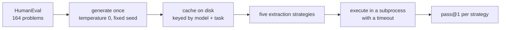

# code-eval-harness

[](https://github.com/hammasbuilds/code-eval-harness/actions/workflows/ci.yml)
[](LICENSE)


We built a HumanEval harness that generates each solution **once**, caches it, and then
scores the identical generations under five ways of pulling the code out of the model's
reply. It is for anyone who reads or publishes code-benchmark numbers and wants to know how
much of a score is the model and how much is the extraction step around it. The answer on
HumanEval: **the same generations score 0% or 85.4%, depending only on extraction.**

## What it does

- Generates one greedy solution per (model, HumanEval problem) through a local Ollama model
  and caches it on disk, so re-scoring never calls the model again.
- Scores every cached generation under five extraction strategies: `raw`, `prompt+body`
  (the original HumanEval completion protocol), `first_fence`, `all_fences` and `smart`.
- Runs each candidate against HumanEval's own `check()` in a subprocess with a timeout, and
  records the failure reason (`SyntaxError`, assertion, timeout) next to the verdict.
- Writes every record to `results/scores.json` and prints pass@1 per strategy and the
  spread between the best and worst strategy for each model.



## Sample input / output

One cached generation from `qwen2.5:14b-instruct` for `HumanEval/2`, scored under all five
strategies (real output, no model call):

````text
model output (qwen2.5:14b-instruct, HumanEval/2), verbatim:
Here is the completed Python function:

```python
def truncate_number(number: float) -> float:
    """ Given a positive floating point number, it can be decomposed into
    ...
    integer_part = int(number)
    decimal_part = number - integer_part
    return decimal_part
```

This function works by first finding the integer part of the number using the `int()`
function, which truncates the decimal part. ...

strategy     verdict
raw          FAIL  SyntaxError: invalid syntax
prompt+body  FAIL  SyntaxError: invalid syntax
first_fence  PASS
all_fences   PASS
smart        PASS
````

The function is correct. The two failing strategies fail because backticks and prose are
not Python.

## Results

All 164 HumanEval problems, greedy decoding, one generation per (model, problem), from
[`results/scores.json`](results/scores.json):

| Model | `raw` | `prompt+body` | `first_fence` | `all_fences` | `smart` |
|---|---:|---:|---:|---:|---:|
| qwen2.5-coder:14b | 0.0% | 0.0% | 85.4% | 85.4% | 85.4% |
| qwen2.5:14b-instruct | 0.0% | 0.0% | 77.3% | 77.3% | 77.3% |

- **85 points of spread from extraction alone.** The generations never changed.
- **Both 0% strategies fail for the same reason**: every failure is a `SyntaxError`, because
  chat models wrap answers in fences. `prompt+body` is the original HumanEval protocol,
  designed for completion models, so a harness built for completion models reports chat
  models as incapable.
- **The three fence rules agree on every one of the 327 records.** The elaborate `smart`
  rule buys nothing over taking the first fenced block, on either model.
- **Code tuning is worth 8.1 points at 14B** (85.4% vs 77.3%, same size, family and
  prompt), consistent with the +10.0 that
  [code-llm-lab](https://github.com/hammasbuilds/code-llm-lab) measures on MBPP for the
  same pair. The instruct run has 163 records: one generation failed and is not scored.

More: [full results and per-strategy failure reasons](docs/RESULTS.md) ·
[the five strategies and what each assumes](docs/METHOD.md).

## Tech stack

- Python 3.11+
- pandas + PyArrow (reading the HumanEval parquet)
- Ollama over HTTP (`urllib`) for local generation: `qwen2.5-coder:14b`, `qwen2.5:14b-instruct`
- `subprocess` with a timeout for execution
- huggingface_hub (optional, to fetch HumanEval once)
- pytest, ruff, GitHub Actions

## Run it

```bash
git clone https://github.com/hammasbuilds/code-eval-harness
cd code-eval-harness
uv sync --all-groups

# HumanEval is read from the local Hugging Face cache; fetch it once:
uv run --with huggingface_hub python -c "from huggingface_hub import hf_hub_download as d; d('openai/openai_humaneval','openai_humaneval/test-00000-of-00001.parquet',repo_type='dataset')"

uv run python src/run_eval.py 164     # score all 164 (needs Ollama for any generation not cached)
uv run pytest -q                      # 19 tests, no network, no model calls
```

The cached generations for both models are committed in `generations/`, so re-scoring the
results above needs no model. Generating new ones needs Ollama running locally with the
models pulled.

`run_tests` executes code written by a language model in a separate process, in a throwaway
temp directory, with a timeout. It is not a security sandbox: do not point it at untrusted
generations on a machine you care about.

```
src/core.py       data loading, generation + cache, five strategies, execution
src/run_eval.py   generate once, score every way, write results/scores.json
tests/            tests using hand-written "model output", no Ollama needed
generations/      cached model outputs, one JSON file per (model, problem)
```

## Licence

MIT, see [LICENSE](LICENSE). HumanEval is by OpenAI (MIT licence).
